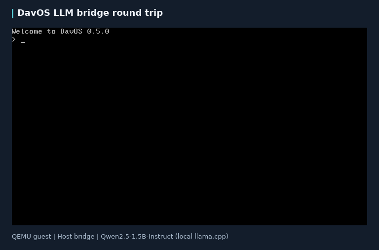

# v0.6.0 Host Agent Bridge

Issue #185 turns the transport probe into a small host service. The service
reads one framed JSON request at a time, delegates planning to a host provider
and writes one framed JSON response. The guest still validates every typed plan
before execution.

## Run with the fake provider

Build the ISO using the [repository build instructions](../../README.md#build-and-run-docker).
Start QEMU on the host with the Agent serial socket.

```sh
make run-agent-transport
```

Then start the bridge in another terminal:

```sh
DAVOS_AGENT_PROVIDER=fake python3 scripts/agent_bridge.py --socket /tmp/davos-agent.sock
```

Switch the guest to the bridge-backed planner and submit a request:

```text
agent llm status
agent mode llm
write notes hello
agent ask what files are available
agent context
agent mode deterministic
```

Expect `LLM bridge: available` and `Provider: fake`. The request lists `notes`,
and `agent context` shows `list_files` as the last action. The status command
checks the host bridge handshake and reports only its provider kind.

The bridge waits for the next request while the guest is idle. `--timeout`
sets the connection and frame I/O deadlines (10 seconds by default). If the
bridge reports `transport_timeout` and exits, restart it before retrying the
guest commands. `--once` keeps the bridge available through the health check
and exits after one planning request.

<!-- coderabbit-ai-generated:v1 -->

<!-- coderabbit-ai-generated-section:v1:d888b738f93a94b761052ad03466f32dafd7c15c8b76cf1d01d8408c9909668f -->

The mode switch succeeds only after the guest receives the bridge health
response. Each `agent ask` request includes the bounded input, the current
session context and the guest-owned action allowlist. A valid response is
converted to the existing typed `Plan`, then passes through the same validator,
safety gate and constrained executor used by deterministic commands.

Serial planning and health requests carry a guest-generated `exchangeId`, a
positive unsigned 64-bit integer unique within the running guest. The host
echoes it in plans, health replies and structured errors for tagged requests.
The guest discards responses with another exchange ID within the original
receive budget.
An untagged plan is a bridge failure. IDs are never reused after failed
exchanges, and planning fails if the counter is exhausted. Update the guest
and host helper together so that responses carry the required ID. The host
still accepts older planning and health requests without an ID.

<!-- /coderabbit-ai-generated:v1 -->

The deterministic fake provider is the default. It needs no network access or
credentials and uses the mappings from the
[v0.5.0 fake bridge](../v0.5.0/fake_llm_bridge.md).

## Timeouts and fallback

The guest allows up to one second for a health check and twelve seconds for
planning. Sending a request and receiving its reply share that budget, including
time spent discarding replies from earlier exchanges. The host's default
ten-second HTTP socket timeout applies to blocking network operations. A
provider call can outlive the guest deadline, and the sequential host bridge can
respond to subsequent requests once that call finishes. The guest reports
provider timeouts, provider disconnects and malformed replies as distinct
errors. If the serial link stops responding, the guest returns a timeout and
the shell resumes at the prompt.

Deterministic fallback is disabled at boot. In the guest, run
`agent llm fallback on` to allow it for timeouts and unavailability, and
`agent llm fallback off` to disable it. The Agent prints a fallback trace and
keeps its selected planner mode. Fallback plans use the same action allowlist,
validation and confirmation rules. A malformed response remains an error even
when fallback is on.

## OpenAI-compatible provider

Start QEMU as above. In a separate Bash terminal on the host, set the endpoint
and model for your provider and enter the key at the hidden prompt. The subshell
keeps the key scoped to the bridge session.

```bash
(
  export DAVOS_AGENT_PROVIDER=openai
  export DAVOS_AGENT_MODEL='<model name>'
  export DAVOS_AGENT_BASE_URL='https://provider.example/v1'
  read -r -s -p 'Provider API key: ' DAVOS_AGENT_API_KEY || exit 1
  printf '\n'
  export DAVOS_AGENT_API_KEY
  python3 scripts/agent_bridge.py --socket /tmp/davos-agent.sock
)
```

The base URL must be the provider's API root; the bridge appends
`/chat/completions`. The API key is used only in the host HTTP authorization
header. It is never logged, included in a transport frame or sent to the guest.
Repeat the guest commands above with the new bridge. The status command should
report `Provider: openai-compatible`. The planning request verifies that the
configured endpoint can return a valid typed plan.

## Troubleshooting

| Symptom | Check |
| --- | --- |
| `LLM bridge: unavailable` | Start QEMU before starting the bridge. Match `AGENT_SERIAL_SOCKET` and `--socket` if you use a custom path, and close any transport probe still attached. |
| `provider_config` on bridge startup | Check the provider kind, API key, model and API root. The bridge appends `/chat/completions`. |
| `agent: bridge timeout` | Check that the host bridge is running and the provider responds within the planning budget described above. Recheck the guest handshake with `agent llm status`. |
| `agent: malformed bridge response` or a provider plan error | Check the chat-completion message for one JSON object with an allowed action and matching arguments. Try the fake provider to isolate the transport and guest runtime. |

After building the ISO, `python3 scripts/test_boot.py --functional` exercises
the QEMU guest with the fake provider and requires no credentials.

## Recorded round trip

The recording runs a pre-release QEMU guest and a local OpenAI-compatible
llama.cpp server with Qwen2.5-1.5B-Instruct (Q4_K_M). The model selects
`list_files` for the sample request. DavOS validates and executes that typed
action, listing `notes`. `agent context` shows the action and its result before
the shell switches back to deterministic mode.



## Boundaries

- `agent_bridge_transport.py` owns the QEMU Unix serial connection.
- `agent_bridge_protocol.py` owns `DV/1` framing and JSON encoding limits.
- `agent_bridge_planner.py` owns the constrained prompt and plan validation.
- `agent_bridge_provider.py` owns fake and OpenAI-compatible provider calls.
- `agent_bridge.py` processes requests sequentially and coordinates errors.

Requests remain limited to 2048 bytes and responses to 1024 bytes. Provider
and protocol failures become bounded JSON error objects. Fatal transport errors
are emitted as the same bounded JSON shape on stderr and terminate the service.
The service does not expose a public network endpoint and never puts provider
configuration or credentials in the kernel.

The provider sees only the user input, lightweight context and OS-provided
action allowlist. Its output must match one known action contract exactly;
unknown fields, disallowed actions and invalid targets become bounded
`planner_error` responses. The guest independently validates every accepted
plan before its safety gate or executor can use it. Transport, protocol and
bridge failures leave the Agent session context unchanged unless an explicitly
enabled fallback produces a valid plan. Deterministic commands remain available
without a host bridge.
